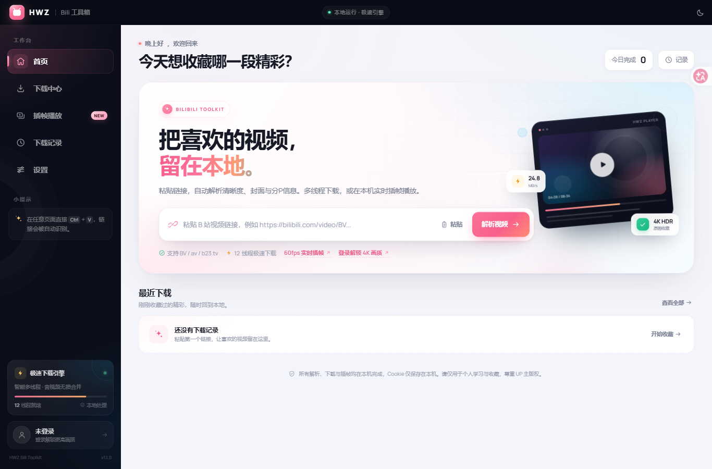
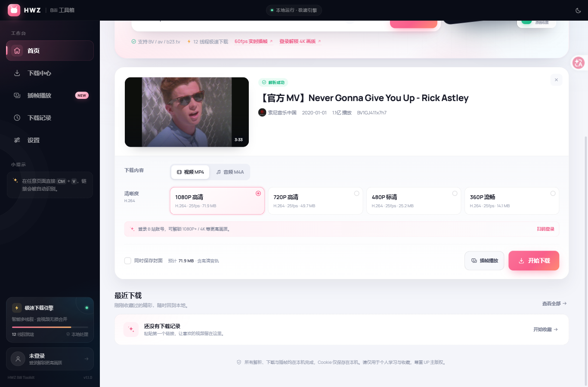
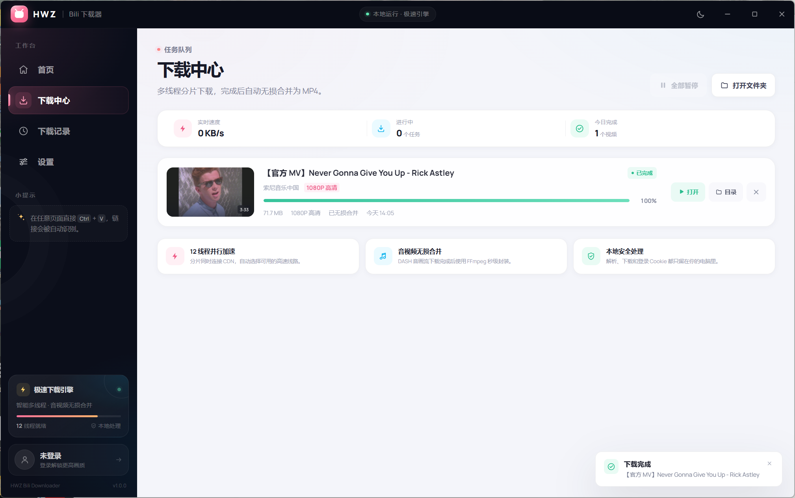
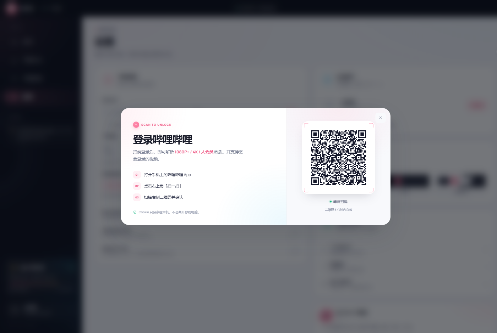

# HWZ Bili 下载器

一个为 Windows 打造的本地 B 站视频下载器：粘贴链接即可自动解析，多线程加速下载，自动合并音视频。

> **GitHub 仓库**：https://github.com/HWZ-ch/HWZ_bili-video-download  
> **直接下载 Windows 免安装版**：[前往 Releases](https://github.com/HWZ-ch/HWZ_bili-video-download/releases/latest)（文件名：`HWZ-Bili.exe`）



## 界面预览

| 解析结果 | 下载中心 |
| --- | --- |
|  |  |

| 扫码登录 | 深色模式 |
| --- | --- |
|  | 在设置或标题栏一键切换，也可以跟随系统。 |

## 功能亮点

- **粘贴即解析、即下载**：复制 B 站链接后在首页按 `Ctrl + V`，应用自动识别、解析，并按推荐清晰度开始下载。想手动选画质时，可在解析结果出现后的 3 秒内点击任意选项取消自动下载。
- **支持 BV / av / b23.tv 短链接**：自动读取标题、封面、UP 主、分P与清晰度。
- **多线程极速下载**：默认 12 路并发分片，自动选择可用的 CDN 线路，可调至 4 / 8 / 12 / 16 线程。
- **音画无损合并**：DASH 视频流与音轨下载完成后，通过 FFmpeg `-c copy` 秒级封装为 MP4，不二次压缩。
- **分P与合辑**：多 P 视频可以直接切换分P，文件名自动保留分P标题。
- **扫码登录**：支持哔哩哔哩 App 扫码登录，解锁 1080P+ / 4K 等更高画质。
- **视频 / 音频双模式**：可下载 MP4 视频，也可只提取最佳音质的 M4A 音频。
- **任务管理**：实时速度、剩余时间、进度、暂停 / 继续 / 取消、断点恢复、打开文件与所在目录。
- **本地下载记录**：记录保存在本机，可以搜索、打开或删除记录（不会误删视频文件）。
- **保存封面**：可勾选同时保存封面 JPG。
- **深色模式**：浅色 / 深色 / 跟随系统。
- **全部本地处理**：解析、下载、Cookie 都在本机完成，不需要上传账号资料。

## 快速开始

1. 双击 `HWZ-Bili.exe`（从 Releases 下载；本地自行构建的文件名为 `HWZ-Bili下载器.exe`）。
2. 复制一个 B 站视频链接，粘贴到首页输入框（或直接在任意页面按 `Ctrl + V`）。
3. 应用会自动识别链接并解析；默认会按推荐清晰度自动开始下载。
4. 想选择分P、清晰度或音频模式时，点击解析结果里的选项即可取消本次自动下载，然后点击「开始下载」。
5. 下载完成后在「下载记录」里直接打开视频或文件夹。

> 自动下载可以在「设置 → 粘贴后自动下载」中关闭。关闭后流程为：粘贴 → 解析 → 选择选项 → 点击「开始下载」。

## 画质说明

| 账号状态 | 通常可用的清晰度 |
| --- | --- |
| 未登录 | 最高通常为 1080P 高清 |
| 已登录 | 可获取账号权限内的 1080P+ / 4K / HDR 等 |

部分视频需要大会员、登录或存在地区限制。受版权保护或需要特殊权限的视频可能无法下载，请以实际解析结果为准。

## 设置

- **保存位置**：默认为 `%USERPROFILE%\Downloads\HWZ Bili下载器`，可在设置中修改。
- **下载线程**：默认 12，网络较差时可降到 8 或 4。
- **视频编码偏好**：H.264（兼容性最好）/ HEVC（体积小）/ AV1（压缩率高）。没有所选编码时会自动回退。
- **保存封面 / 完成后打开文件夹 / 粘贴后自动下载**：可在设置中随时开关。
- **清理缓存**：删除临时分片、封面缓存和解析缓存，不影响已经下载的文件。

## 支持范围

当前支持 **B 站普通视频投稿**、多 P 视频 / 合辑页，以及 B 站短链接。  
暂不支持：直播、番剧 / 影视等 PGC 内容、互动视频分支、充电专属视频。后续可扩展。

## 隐私与数据

- 应用只在本机 `127.0.0.1` 上提供界面服务，不监听公网。
- 登录 Cookie 只保存在 `%LOCALAPPDATA%\HWZ-Bili-Downloader\cookies.json`，用于向 B 站请求你有权限的内容。
- 封面图片会缓存在本机；下载记录保存在本机 `history.json`。
- 退出应用不会上传任何记录。

## 常见问题

**打不开界面 / 提示缺少 WebView2**  
Windows 11 与大多数 Windows 10 已内置 Microsoft Edge WebView2。如未安装，请从微软官网安装「Microsoft Edge WebView2 Runtime」。

**解析报 412 / 风控**  
B 站对高频请求会触发风控。稍等几分钟再试，扫码登录通常能降低触发概率。

**下载到一半提示链接过期**  
B 站 CDN 地址有有效期。重新解析视频并重新下载即可；已完成的文件不受影响。

**视频没有声音 / 只有画面**  
应用会自动把视频与音轨合并。若合并失败，检查磁盘空间，并通过「设置 → 清理缓存」后重试。

**文件保存在哪里？**  
默认在 `下载\HWZ Bili下载器`；点击任意下载完成后的「目录」按钮即可打开。也可以在设置里改到其他磁盘。

## 开发

环境：Windows 10/11、Python 3.12。

```powershell
python -m pip install -r requirements-build.txt
python app.py --browser --no-window --port 8765 --debug
```

开发模式会输出本地访问地址，方便在浏览器里调试；带上日志中的 `?t=...` 访问即可。

构建单文件 exe：

```powershell
python -m pip install -r requirements-build.txt
powershell -ExecutionPolicy Bypass -File .\build.ps1
```

`build.ps1` 会自动下载兼容版本的 FFmpeg 到 `vendor/bin/ffmpeg.exe`（源码仓库不提交大体积二进制），然后调用 PyInstaller 打包。产物在 `dist\HWZ-Bili下载器.exe`，并自动复制一份到项目根目录。

### 项目结构

```
app.py                启动入口、WebView2 窗口与 pywebview JS 桥
hwz/
  bili.py             B 站链接解析、WBI 签名、清晰度、扫码登录
  downloader.py       多线程分片下载、断点、合并、任务管理
  server.py           本地 HTTP API 与静态资源
  store.py            设置与下载记录
  config.py           路径与全局配置
web/                  前端界面（原生 HTML/CSS/JS）
tests/                无网络冒烟测试
vendor/bin/ffmpeg.exe 音视频封装组件（构建时自动下载，不提交）
vendor/licenses/      第三方许可证
HWZ-Bili.spec         PyInstaller 打包配置
```

> 发布版可直接从 Releases 下载，无需自行构建。

## 免责声明

本项目仅供个人学习、技术研究与本地收藏使用。请遵守哔哩哔哩用户协议与相关法律法规，不要用于商业传播或侵犯 UP 主版权的行为。下载内容的版权归原作者及权利人所有。

## License

本项目代码以 MIT License 发布。随附的第三方组件（特别是 FFmpeg）遵循其各自的许可证，详见 [THIRD_PARTY_NOTICES.md](THIRD_PARTY_NOTICES.md)。

